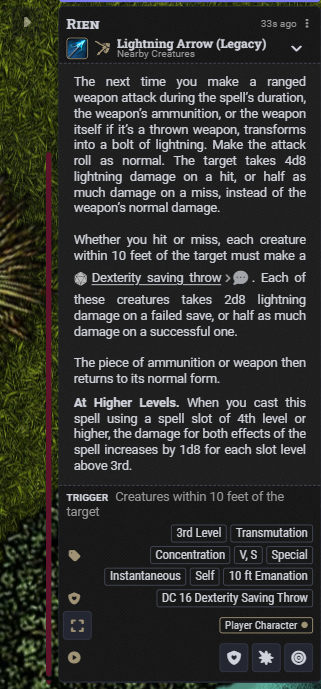
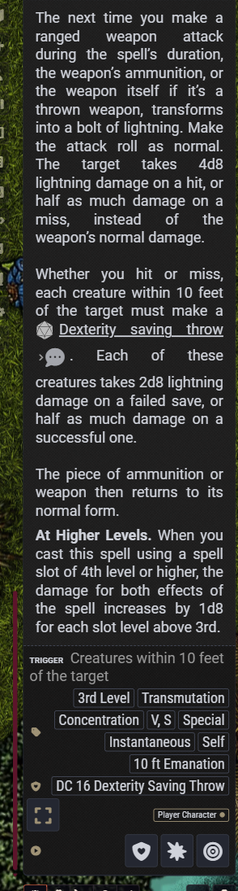
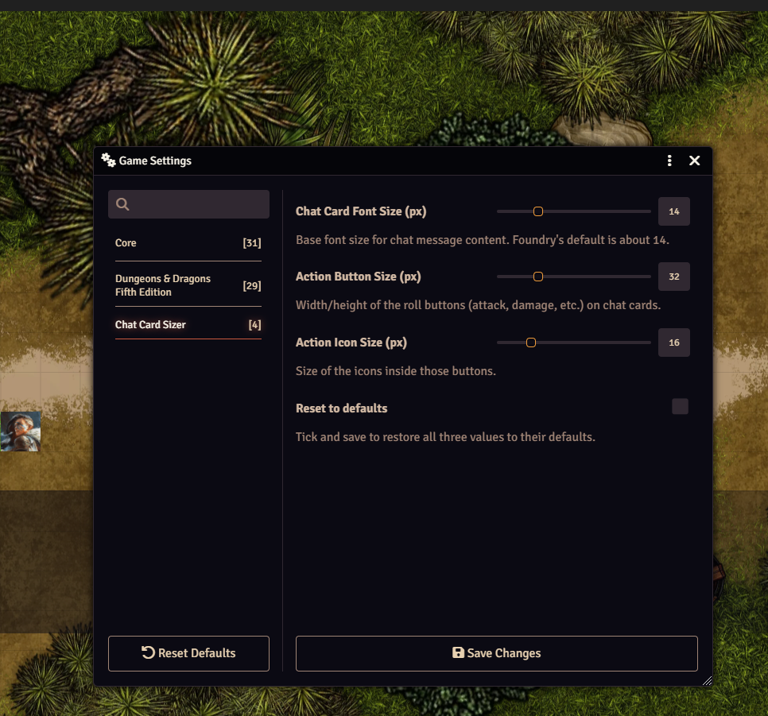
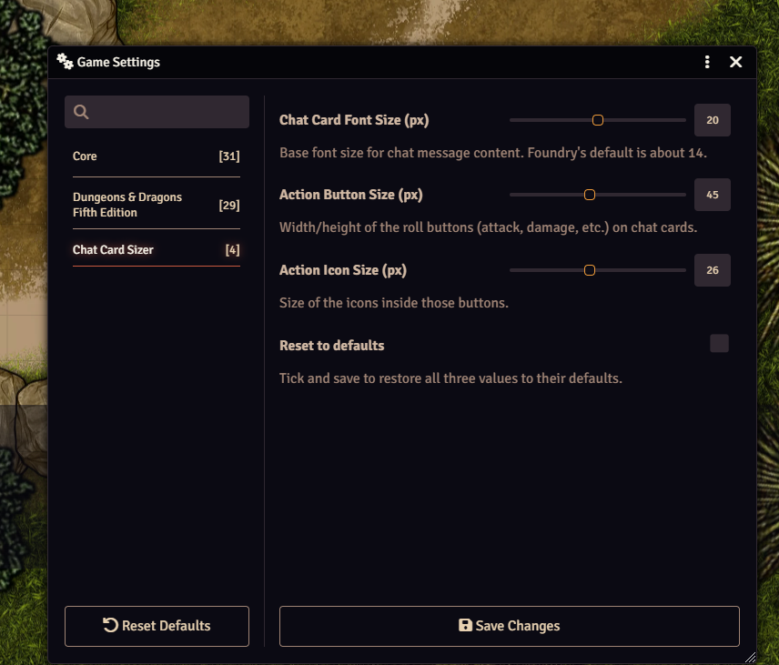

# Chat Card Sizer

Foundry VTT module (v13–v14, dnd5e 5.0+) that makes chat cards easier to read. Each player can raise the chat text size and the size of the roll buttons (attack, damage, save, healing and the small icon buttons) and their icons. Made for players with low vision.

## Before and after

| Default | With Chat Card Sizer |
| :---: | :---: |
|  |  |

## Settings

Every player sets their own sizes in **Configure Settings → Chat Card Sizer**. A change only affects that player's screen.

| Default | Enlarged |
| :---: | :---: |
|  |  |

- **Chat Card Font Size** – text in chat cards, including button labels
- **Action Button Size** – width and height of the roll buttons
- **Action Icon Size** – the icons inside those buttons
- **Reset to defaults** – tick and save to go back to 14 / 32 / 16

## Install

In Foundry: **Add-on Modules → Install Module**, paste this manifest URL:

```
https://raw.githubusercontent.com/siller94-art/chat-card-sizer/main/module.json
```

Then enable it in your world. After an update, everyone should press F5.
